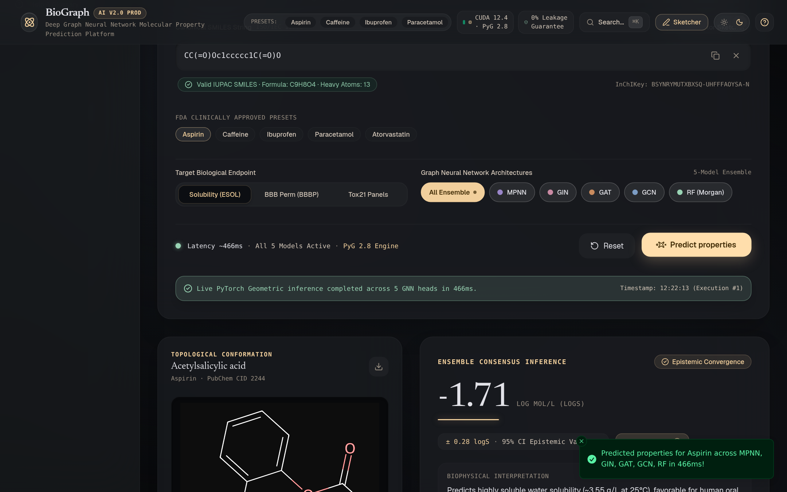
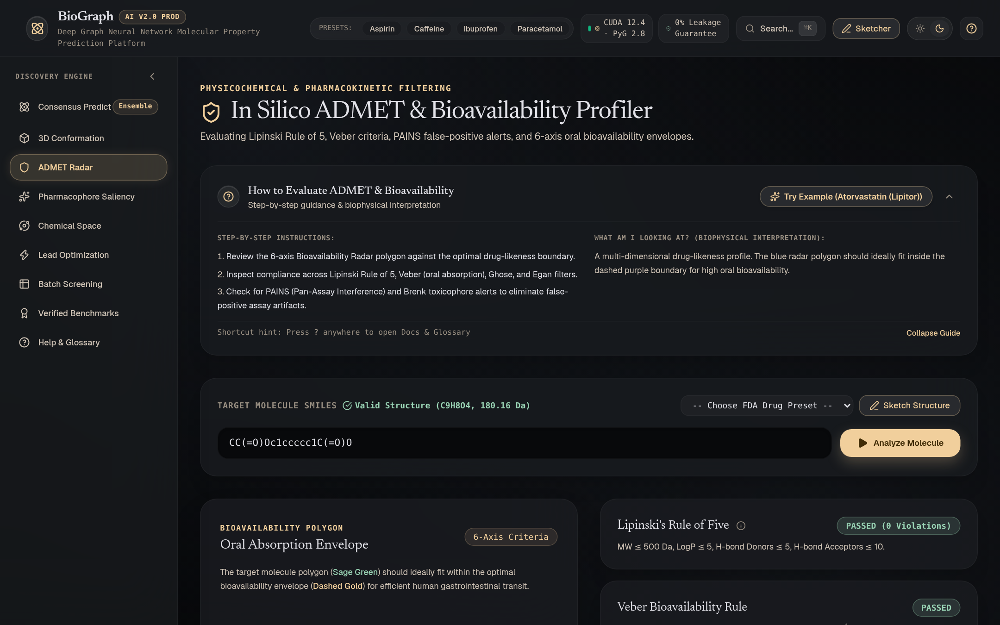
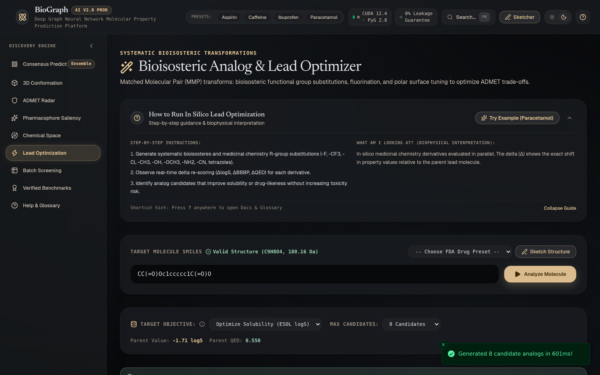
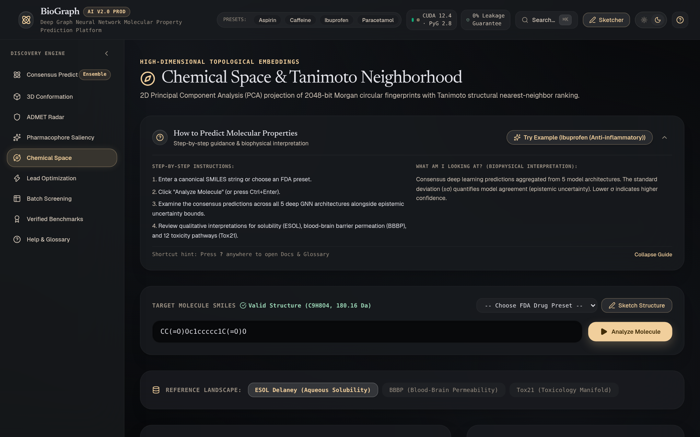
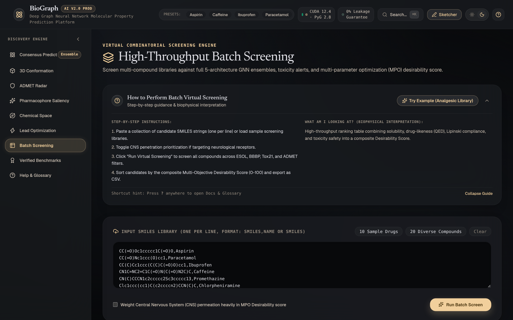

# BioGraph AI — Deep Graph Neural Networks for Molecular Discovery

[](https://www.python.org/)
[](https://pyg.org/)
[](https://www.rdkit.org/)
[](https://fastapi.tiangolo.com/)
[](https://react.dev/)
[-brightgreen.svg)](#scaffold-splitting)
[](LICENSE)

An enterprise-grade, CPU-optimized Computer-Aided Drug Discovery (CADD) platform that predicts chemical bioactivities, ADMET profiles, and toxicological liabilities directly from 2D molecular topologies using Graph Neural Networks (MPNN, GIN, GAT, GCN) and RDKit cheminformatics.

<div align="center">
  
</div>

---

## 🖼 Platform Interface & Visual Tour

### 1. Multi-Model Molecular Property Predictor
Consensus epistemic uncertainty estimation across MPNN, GIN, GAT, GCN, and Random Forest baselines alongside live RDKit 2D Kekulé vector projections.
<div align="center">
  
</div>

<br/>

### 2. 3D Stereochemical Conformation & Force-Field Studio
Low-energy 3D molecular conformers generated using ETKDGv3 distance-geometry physics and MMFF94 force-field relaxation rendered via interactive WebGL with camera reset and fullscreen mode.
<div align="center">
  
</div>

<br/>

### 3. In Silico ADMET & Bioavailability Radar
Comprehensive oral bioavailability polygon radar chart evaluating Lipinski Rule of 5, Veber, Ghose, Egan, and PAINS/Brenk structural alert catalogs.
<div align="center">
  
</div>

<br/>

### 4. In Silico Lead Optimization & Matched Molecular Pairs
Systematic bioisosteric substitutions, fluorinations, and polar surface tuning ranking candidate analogs with predicted deltas and QED drug-likeness.
<div align="center">
  
</div>

<br/>

### 5. Chemical Space & Tanimoto Structural Search
High-dimensional 2048-bit Morgan fingerprint representations projected into 2D chemical space via PCA with nearest-neighbor structural retrieval.
<div align="center">
  
</div>

<br/>

### 6. Explainable AI: GNNExplainer Attribution
Information-theoretic sub-graph mutual information masks isolating the key pharmacophoric functional groups driving deep graph neural predictions.
<div align="center">
  
</div>

<br/>

### 7. High-Throughput Virtual Screening Engine
Batch screening pipeline ranking compound libraries using a multi-objective Drug Desirability Score (0–100) with one-click CSV export.
<div align="center">
  
</div>

---

## 🔬 Platform Architecture & Capabilities

- **Atom & Bond Graph Featurization**: Converts raw SMILES strings into PyTorch Geometric (PyG) attributed graphs using 48-dimensional atomic vectors and 10-dimensional directed bond vectors with full stereochemical encoding.
- **Strict Bemis-Murcko Scaffold Splitting**: Deterministically clusters molecules by cyclic Bemis-Murcko core structures and partitions clusters into 80/10/10 train/val/test splits, strictly verifying **0% scaffold leakage** to prevent optimistic test inflation.
- **5 Multi-Inductive Graph & Classical Architectures**:
  - **MPNN (Message Passing Neural Network)**: Edge-conditioned convolution (`NNConv`) with multi-layer perceptron bond feature mapping.
  - **GIN (Graph Isomorphism Network)**: Multilayer perceptron aggregation maximizing graph discrimination up to the 1-Weisfeiler-Lehman (1-WL) isomorphism test.
  - **GAT (Graph Attention Network)**: Multi-head self-attention mechanisms over bonded atomic neighborhoods.
  - **GCN (Graph Convolutional Network)**: Normalized symmetric spectral neighborhood aggregation.
  - **Classical Baseline**: 2048-bit Morgan Fingerprints (ECFP4) paired with Random Forest / Gradient Boosting.
- **Dual Global Pooling**: Concatenation of Global Mean Pooling and Global Sum Pooling (`[mean_pool || add_pool]`), jointly capturing intensive concentration properties and extensive molecular size features.
- **GNNExplainer Substructure Attribution**: Information-theoretic graph masking identifying key pharmacophores driving individual predictions with RDKit 2D vector highlights.
- **Interactive 3D Molecular Conformer Studio**: Low-energy 3D stereochemical conformers generated via ETKDGv3 distance-geometry physics and MMFF94 force field relaxation, rendered via interactive WebGL (3Dmol.js) with fullscreen inspection.
- **ADMET Bioavailability Radar**: Multi-metric oral bioavailability assessment (Lipinski Rule of 5, Veber, Ghose, Egan) alongside PAINS and Brenk structural alert catalogs.
- **In Silico Lead Optimization**: Matched Molecular Pair (MMP) transform engine evaluating bioisosteric substitutions, fluorinations, and polar surface tuning.
- **High-Dimensional Chemical Space**: 2D Principal Component Analysis (PCA) projection of 2048-bit circular fingerprints with Tanimoto structural nearest-neighbor ranking.
- **High-Throughput Virtual Screening**: High-performance screening pipeline ranking compound candidate libraries using a multi-objective Drug Desirability Score (0–100) with CSV export.

---

## 📊 Benchmark Results (Bemis-Murcko Test Split)

Evaluated on held-out Bemis-Murcko scaffold test sets with verified zero structural overlap:

### 1. Aqueous Solubility (ESOL — Delaney Regression, $\log S$ in $\text{mol/L}$)
| Architecture | Test RMSE ↓ | Test MAE ↓ | Test $R^2$ ↑ | Training Time (s) |
| :--- | :---: | :---: | :---: | :---: |
| **MPNN (NNConv)** | **1.010** | **0.777** | **0.784** | 43.1s |
| **GIN** | 1.054 | 0.812 | 0.764 | 15.2s |
| **GCN** | 1.080 | 0.811 | 0.753 | 13.6s |
| **Baseline (RF ECFP4)** | 1.109 | 0.859 | 0.739 | 1.6s |
| **GAT** | 1.208 | 0.938 | 0.691 | 20.5s |

### 2. Blood-Brain Barrier Penetration (BBBP — Binary Classification)
| Architecture | Test ROC-AUC ↑ | Test PR-AUC ↑ | Training Time (s) |
| :--- | :---: | :---: | :---: |
| **Baseline (RF ECFP4)** | **0.853** | **0.978** | 2.2s |
| **GIN** | 0.723 | 0.936 | 36.7s |
| **GCN** | 0.719 | 0.951 | 20.5s |
| **MPNN (NNConv)** | 0.665 | 0.944 | 121.9s |
| **GAT** | 0.624 | 0.928 | 43.9s |

### 3. Toxicity Profiling (Tox21 — 12 Multi-Task Classification with Missing Label Masking)
| Architecture | Test ROC-AUC ↑ | Test PR-AUC ↑ | Training Time (s) |
| :--- | :---: | :---: | :---: |
| **MPNN (NNConv)** | **0.757** | 0.304 | 743.9s |
| **GCN** | 0.754 | 0.310 | 68.0s |
| **GIN** | 0.747 | 0.306 | 57.2s |
| **Baseline (RF ECFP4)** | 0.730 | **0.349** | 19.9s |
| **GAT** | 0.711 | 0.264 | 68.4s |

---

## 🧮 Mathematical Foundations

### Attributed Molecular Graph Representation
Each molecule is represented as $\mathcal{G} = (\mathcal{V}, \mathcal{E})$:
- **Node Matrix** $\mathbf{X} \in \mathbb{R}^{|\mathcal{V}| \times 48}$: One-hot atomic number (44 common elements), degree, formal charge, hybridization ($\text{sp, sp}^2\text{, sp}^3\text{, sp}^3\text{d, sp}^3\text{d}^2$), aromaticity, and implicit hydrogen count.
- **Edge Tensor** $\mathbf{E} \in \mathbb{R}^{|\mathcal{E}| \times 10}$: Bond type (Single, Double, Triple, Aromatic), conjugation flag, ring membership, and stereochemical configuration.

### Message Passing Formulations

1. **Graph Convolutional Network (GCN)**:
   $$\mathbf{h}_i^{(l+1)} = \sigma\left(\mathbf{W}^{(l)} \sum_{j \in \mathcal{N}(i) \cup \{i\}} \frac{1}{\sqrt{\tilde{d}_i \tilde{d}_j}} \mathbf{h}_j^{(l)}\right)$$

2. **Graph Attention Network (GAT - Multi-Head)**:
   $$\mathbf{h}_i^{(l+1)} = \Vert_{k=1}^K \sigma\left(\sum_{j \in \mathcal{N}(i)} \alpha_{ij}^k \mathbf{W}^k \mathbf{h}_j^{(l)}\right), \quad \alpha_{ij} = \text{Softmax}_j\left(\text{LeakyReLU}\left(\mathbf{a}^\top [\mathbf{W}\mathbf{h}_i \,\|\, \mathbf{W}\mathbf{h}_j]\right)\right)$$

3. **Graph Isomorphism Network (GIN)**:
   $$\mathbf{h}_i^{(l+1)} = \text{MLP}^{(l)}\left(\left(1 + \epsilon^{(l)}\right)\mathbf{h}_i^{(l)} + \sum_{j \in \mathcal{N}(i)} \mathbf{h}_j^{(l)}\right)$$

4. **Message Passing Neural Network (MPNN / NNConv)**:
   $$\mathbf{h}_i^{(l+1)} = \mathbf{\Theta} \mathbf{h}_i^{(l)} + \sum_{j \in \mathcal{N}(i)} \mathbf{h}_j^{(l)} \cdot h_{\mathbf{\Theta}'}\left(\mathbf{e}_{ji}\right)$$
   where $h_{\mathbf{\Theta}'}(\cdot)$ is a 2-layer neural network generating edge-specific transformation matrices from bond attributes $\mathbf{e}_{ji}$.

### Dual Global Readout
$$\mathbf{h}_{\mathcal{G}} = \left[\frac{1}{|\mathcal{V}|}\sum_{i \in \mathcal{V}} \mathbf{h}_i^{(L)} \;\Bigg\|\; \sum_{i \in \mathcal{V}} \mathbf{h}_i^{(L)}\right] \in \mathbb{R}^{2 \cdot d_{\text{hidden}}}$$

---

## 📂 Repository Structure

```
BioGraph-AI/
├── app/
│   └── server.py              # High-performance FastAPI REST server & SPA static handler
├── configs/
│   ├── bbbp.yaml              # Hyperparameters for BBBP classification
│   ├── esol.yaml              # Hyperparameters for ESOL regression
│   └── tox21.yaml             # Hyperparameters for Tox21 multi-task classification
├── data/
│   ├── raw/                   # Raw MoleculeNet benchmark CSVs (ESOL, BBBP, Tox21)
│   └── processed/             # Cached PyG dataset bundles (.pt, generated locally)
├── docs/
│   ├── screenshots/           # High-resolution platform UI walkthrough screenshots
│   └── TECHNICAL_REFERENCE.md # In-depth technical specifications & math derivations
├── frontend/
│   ├── public/                # Static assets, favicon, JSME sketcher bundle
│   ├── src/                   # React 18 + Tailwind CADD Discovery Studio
│   │   ├── components/        # Reusable UI widgets (Radar, 3D Conformer, Footers)
│   │   ├── pages/             # Studio views (Predict, ADMET, Conformer, Analogs, Space, Batch)
│   │   └── store/             # Zustand persistent application store
│   ├── package.json
│   └── vite.config.ts
├── results/
│   ├── checkpoints/           # Trained PyG weights (.pt) and Random Forest baselines (.pkl)
│   ├── history/               # Per-epoch training & validation loss trajectories (.json)
│   ├── plots/                 # Parity plots, ROC/PR curves, and t-SNE latent visualizations
│   └── REPORT.md              # Markdown benchmark summary
├── src/
│   ├── admet.py               # Lipinski/Veber/Ghose rules, PAINS/Brenk alert filters
│   ├── analogs.py             # Matched Molecular Pair bioisostere generation
│   ├── batch_screen.py        # High-throughput compound library screening engine
│   ├── chemical_space.py      # 2D PCA latent projections & Tanimoto structural neighbors
│   ├── conformers.py          # 3D ETKDGv3 embedding & MMFF94 force-field relaxation
│   ├── data.py                # SMILES parser, 48d/10d featurizer, scaffold splitter
│   ├── ensemble.py            # Epistemic uncertainty quantification & multi-model consensus
│   ├── evaluate.py            # Evaluation metrics & diagnostic plot generation
│   ├── explain.py             # GNNExplainer attribution & 2D RDKit rendering
│   ├── train.py               # Masked loss training loop with early stopping
│   └── models/
│       ├── baseline.py        # 2048-bit Morgan Fingerprint Random Forest baseline
│       └── gnn.py             # GCN, GAT, GIN, and MPNN (NNConv) PyG modules
├── tests/                     # Comprehensive test suite (49 pytest test cases)
├── pytest.ini                 # Pytest configuration
├── requirements.txt           # Pinned CPU dependencies (PyG, RDKit, FastAPI, Scikit-learn)
├── setup.sh                   # Automated CPU environment setup script
├── start.sh                   # One-click unified launch script (Backend + Studio)
└── README.md                  # Project documentation
```

---

## 🚀 Quickstart Guide

### 1. Prerequisites
- **Operating System**: Linux (Ubuntu 20.04+ recommended) or macOS
- **Python**: 3.10+
- **Node.js**: v18+ and `npm`

### 2. Environment Setup
Clone the repository and run the automated setup script:
```bash
git clone https://github.com/VSRAJHAVEL/BioGraph-AI.git
cd BioGraph-AI

# Automated CPU-optimized virtual environment setup
bash setup.sh
source .venv/bin/activate
```

### 3. Launch Unified Platform
Start the unified production server (serves the FastAPI backend and compiled React studio simultaneously on port 8000):
```bash
./start.sh
```
Open **[http://localhost:8000](http://localhost:8000)** in your browser.
Interactive OpenAPI/Swagger documentation is available at **[http://localhost:8000/docs](http://localhost:8000/docs)**.

For development mode with Hot Module Replacement (HMR):
```bash
./start.sh --dev
```

### 4. Run Test Suite
Run all 49 backend and integration test cases:
```bash
pytest tests/
```

### 5. CLI Model Training & Evaluation
Train models from scratch or evaluate existing checkpoints:
```bash
# Smoke test (2 epochs)
python src/train.py --dataset esol --model gcn --quick

# Full training run across all 5 architectures on ESOL
python src/train.py --dataset esol --model all

# Train on BBBP or Tox21
python src/train.py --dataset bbbp --model all
python src/train.py --dataset tox21 --model all --seeds 42

# Generate diagnostic parity plots, ROC/PR curves, and t-SNE embeddings
python src/evaluate.py

# Explain functional groups with GNNExplainer
python src/explain.py --model mpnn --dataset esol --smiles "CC(=O)Oc1ccccc1C(=O)O" --output results/plots/aspirin_esol_mpnn.png
```

---

## 🌐 REST API Endpoints

| Method | Endpoint | Description |
| :--- | :--- | :--- |
| `GET` | `/api/health` | Healthcheck and loaded architecture status |
| `POST` | `/api/validate` | Validates SMILES valence, generates formula and InChIKey |
| `POST` | `/api/analyze` | Full molecular profile: 5-GNN inference, ADMET, 3D conformer, 2D vector |
| `POST` | `/api/predict` | Property inference for specific dataset & architecture |
| `POST` | `/api/explain` | GNNExplainer node/edge attribution weights and highlighted SVG |
| `POST` | `/api/conformer` | 3D atomic coordinates, MMFF94 energy, and SDF block |
| `POST` | `/api/analogs` | Generates bioisosteric MMP analog candidates |
| `POST` | `/api/chemical-space` | 2D PCA projection coordinates and top-$K$ Tanimoto neighbors |
| `POST` | `/api/batch-screen` | Batch library screening with Drug Desirability scoring |
| `GET` | `/api/benchmarks` | Benchmark metrics across all evaluated architectures |

---

## 👨‍💻 Author & Engineering Credits

**Handcrafted by RAJHAVEL V S**

- 🌐 **Portfolio Website**: [vsrajhavel.github.io](https://vsrajhavel.github.io)
- 💼 **LinkedIn Profile**: [linkedin.com/in/rajhavelvs](https://in.linkedin.com/in/rajhavelvs)
- 🐙 **GitHub Repository**: [github.com/VSRAJHAVEL/BioGraph-AI](https://github.com/VSRAJHAVEL/BioGraph-AI)

---

## 📜 License

This project is distributed under the **MIT License**. See the `LICENSE` file for details.
