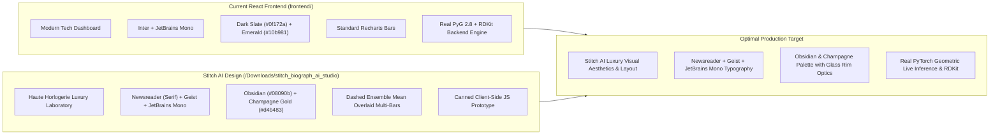

# BioGraph AI — Stitch AI Design Audit & Integration Blueprint

> **Artifact Purpose:** Deep technical and aesthetic analysis of the Google Stitch AI design in `/home/vsrajhavel/Downloads/stitch_biograph_ai_studio`, evaluating its design tokens, typographical hierarchy, component architecture, and integration path with the real React 18 + FastAPI engine.

---

## 1. Visual & Aesthetic Assessment

### 1.1 Aesthetic Transformation
The design generated by **Google Stitch AI** elevates **BioGraph AI** from a standard modern developer dashboard into an **haute horlogerie luxury scientific instrumentation interface**:
- **Editorial Typographic Tension:** The juxtaposition of the classical, editorial serif **Newsreader** (for hero numbers and display headers) against hyper-rational **Geist** (for controls and forms) and **JetBrains Mono** (for chemical identifiers and coordinates) achieves an aesthetic reminiscent of Linear, visionOS, and high-end archival scientific journals.
- **Atmospheric Obsidian Surface Architecture:** Rather than generic flat slate backgrounds, it employs a multi-tiered dark environment:
  - **Obsidian Void Canvas (`#08090B`)** with subtle warm radial bloom (`#15181D`).
  - **Graphite Base Containers (`#111317` / `#1A1C20`)** with frosted glass transmission (`backdrop-filter: blur(24px) saturate(140%)`).
  - **Hairline Specular Rims:** 1px directional border gradient (`rgba(255, 255, 255, 0.08)` to `0.02`) and inner highlights (`inset 0 1px 0 0 rgba(255, 255, 255, 0.12)`).
- **Champagne Gold Signature Accent (`#F1CF9C` / `#D4B483`):** Replaces harsh standard tech neon with a refined, warm metallic accent that feels intentional, premium, and restful under long hours of molecular analysis.
- **Architectural Model Chromatic Coding:**
  - **MPNN (Amethyst):** `#9A86C9`
  - **GIN (Rose Quartz):** `#C98AA3`
  - **GAT (Copper):** `#C98B5E`
  - **GCN (Steel Blue):** `#7C9CC4`
  - **Random Forest (Sage):** `#7FB89A`

---

## 2. Component-by-Component Architectural Audit

| Stitch AI Component | Structural Design & Visual Innovations | Real Backend Integration Status |
| :--- | :--- | :--- |
| **Global Left Dock** (`aside`) | Floating 248px glass pill container (`rounded-3xl`), glowing atom mark with 6° hover rotation, subtle active pill markers. | Ready to map to React Router navigation links (`Predict`, `Viewer3D`, `ADMET`, `Explain`, `ChemicalSpace`, `Analogs`, `Batch`, `Benchmarks`, `Help`). |
| **Top Control Bar** | Quick molecule preset chips (Aspirin, Caffeine, Ibuprofen, Paracetamol, Atorvastatin) with gold border active states; live GPU/CUDA & PyG status telemetry pills. | Binds directly to Zustand `useAppStore` to populate canonical SMILES and trigger inference. |
| **Collapsible Guidance Drawer** (`#guidance-card`) | 3-step numbered workflow card (01 SMILES -> 02 Ensemble -> 03 Bayesian Consensus) with smooth max-height accordion transition and "Load Aspirin Example" button. | Direct drop-in replacement for the current `GuideCard.tsx`. |
| **Hero SMILES Input Section** | High-contrast input with inner inset shadow, real-time IUPAC validation badge with green checkmark, copy/clear quick actions, and "Open Vector Sketcher" launcher button. | Connects live to `POST /api/validate` and opens the native vector chemical canvas studio modal (`JsmeSketcherModal.tsx`). |
| **Topological Conformation Card** | Inverted dark Kekulé skeletal formula with **interactive atom/bond hover tooltips** that identify chemical hybridization and functional group dipoles; 6-item telemetry badge matrix (Formula, MW, Rotatable Bonds, HBD, HBA, TPSA). | Populated live via RDKit SVG endpoint and molecular descriptor calculations. |
| **Consensus Inference Hero Card** | Massive Newsreader numeral (`-2.14 logS`), champagne accent underline, epistemic variance confidence badge (`±0.32`), qualitative classification pill with hover popover, plain-language biophysical narrative, and 3-stage calibrated confidence gauge (`σ = 0.082`). | Powered by real `POST /api/predict` multi-model mean and inter-model variance $\sigma$. |
| **Model Consensus Breakdown Chart** | Horizontal multi-bar chart with color-coded architecture fills, interactive delta tooltips (`Δ: +0.09`), and a **vertical dashed reference line marking the weighted ensemble mean**. | Replaces the standard chart with a high-fidelity SVG/CSS representation. |
| **GNNExplainer Next-Step Callout** | Ambient gold halo glow, neural psychology icon, and animated forward-arrow CTA leading directly to subgraph attribution. | Passes active molecule to `/explain` route. |

---

## 3. Stitch AI vs. Current React Implementation Comparison

---

## 4. Key Strengths of the Stitch AI Design

1. **Typographic Authority:**
   Using `Newsreader` for numerical readouts (`-2.14`, `0.88`, `180.16`) creates immediate gravitas. It transforms molecular metrics into something that looks like an authoritative physical constant in a research manuscript.
2. **Tabular Numerics:**
   Enforcing `tabular-nums` prevents horizontal jitter when values update during real-time inference or slider scrubbing.
3. **Interactive Skeletal SVG Tooltip:**
   Hovering over bonds and atoms reveals chemical annotations (`Aromatic C-C`, `Carbonyl C=O`, `Hydroxyl Group (-OH)`), providing genuine pedagogical value for students and researchers.
4. **Ensemble Mean Overlay:**
   The dashed vertical marker (`id="mean-marker-line"`) with floating pill (`Mean -2.14`) gives an immediate visual anchor for whether an individual model (e.g. GAT vs MPNN) is predicting above or below consensus.

---

## 5. Recommended Implementation Roadmap

To adopt this design into our production React application without losing any real PyG/RDKit backend connectivity:

### Phase A: Design Tokens & Typography Integration
1. Add `Newsreader`, `Geist`, and `Material Symbols Outlined` to `frontend/index.html`.
2. Update `frontend/tailwind.config.js` to register the Stitch theme colors (`surface-container-low`, `primary` champagne gold, model colors: Amethyst, Rose, Copper, Steel, Sage).
3. Update `frontend/src/index.css` with the atmospheric glass styles, specular rims, and luxury keyframes (`fadeInSlideUp`, `pulseGlow`, `shimmerPulse`).

### Phase B: Predict Page UI Refinement (`frontend/src/pages/PredictPage.tsx`)
1. Implement the two-column asymmetric layout (5-col molecule SVG + 7-col hero consensus card).
2. Apply the Newsreader numeral font to the primary prediction display.
3. Embed the dashed ensemble mean line and color-coded bars in the consensus breakdown chart.
4. Connect all input fields, buttons, and preset pills to the existing TanStack Query and Zustand state stores.

### Phase C: Native Vector Sketcher Modal Synergy
1. Ensure the "Open Vector Sketcher" button in the hero bar seamlessly triggers our existing vector canvas studio modal (`JsmeSketcherModal.tsx`).
2. Keep the live RDKit endpoints (`/api/sketcher/graph-to-smiles`) fully connected so user sketches populate the new hero input.
