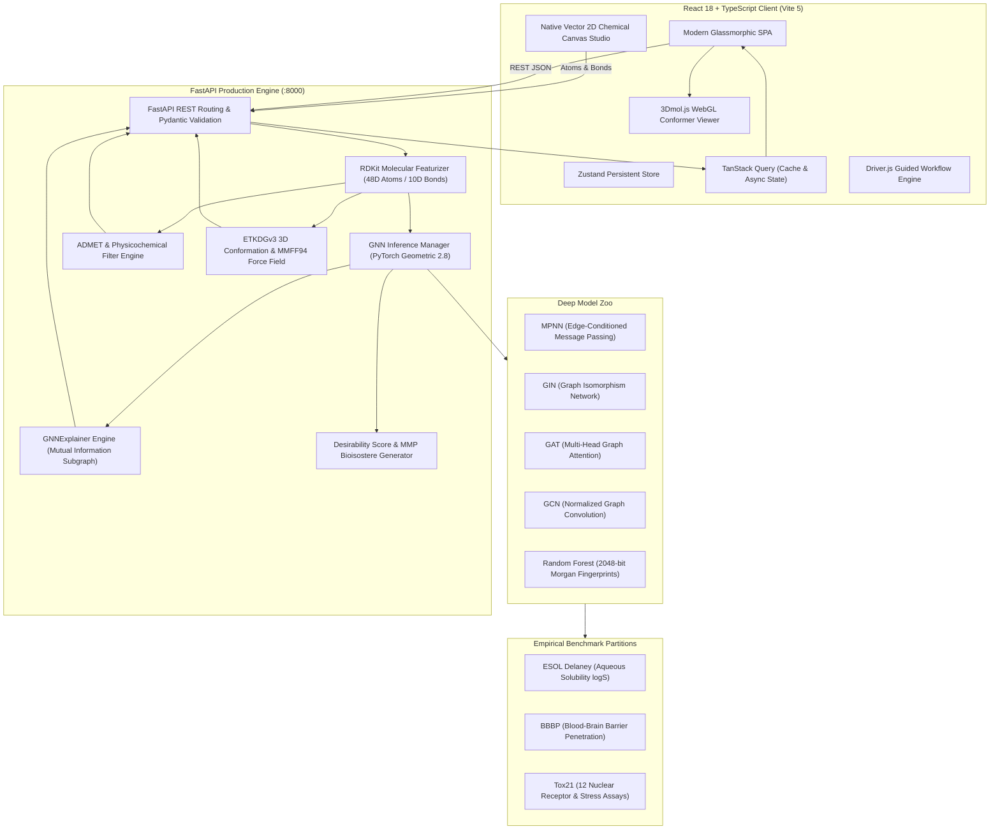

# BioGraph AI: Deep Graph Neural Network Molecular Property Prediction Platform
## Comprehensive Technical Reference & Architecture Documentation

---

## 1. Executive Summary & Problem Formulation

### 1.1 Context in Computer-Aided Drug Discovery (CADD)
Traditional high-throughput screening (HTS) in early-stage preclinical drug discovery requires testing millions of physical chemical entities in wet-lab bioassays. This process is prohibitively expensive (often exceeding $2.6 billion per approved new molecular entity) and exhibits high attrition rates due to unforeseen toxicity, poor aqueous solubility, or failure to penetrate the blood-brain barrier (BBB).

In-silico Quantitative Structure-Activity/Property Relationship (QSAR/QSPR) models accelerate this pipeline by screening virtual combinatorial libraries before physical synthesis. However, historical computational approaches suffer from severe structural limitations:
- **1D Strings (SMILES):** Sequential text representations processed via Recurrent Neural Networks (RNNs) or Transformers often generate syntactically invalid molecules and miss the 2D topological connectivity of cyclic/fused ring systems.
- **Fixed-length Bit Vectors (Morgan / ECFP Fingerprints):** Fixed hash vectors lose continuous stereoelectronic graph topology and cannot capture local atomic environment changes induced by subtle substitutions (e.g., the "magic methyl" or bioisosteric fluorination effects).

### 1.2 The Graph-Centric Paradigm
**BioGraph AI** represents molecules as **attributed, bidirectional molecular graphs** $G = (V, E, X_v, X_e)$, where:
- $V = \{v_1, \dots, v_n\}$ represents atoms (nodes).
- $E = \{(u, v)\}$ represents covalent chemical bonds (edges).
- $X_v \in \mathbb{R}^{n \times 48}$ represents rich continuous and one-hot atomic feature tensors.
- $X_e \in \mathbb{R}^{m \times 10}$ represents continuous and one-hot bond feature tensors.

By utilizing permutation-invariant and edge-conditioned Graph Neural Networks (MPNN, GIN, GAT, GCN), BioGraph AI learns quantum-chemical and topological representations directly from molecular graph graphs, enabling out-of-distribution generalization across structural chemical space.

---

## 2. System Architecture & High-Level Topology



---

## 3. Molecular Graph Featurization Specification

Every input molecule is featurized into PyTorch Geometric tensors using RDKit (`src/data.py`).

### 3.1 Node (Atom) Features — 48 Dimensions ($X_v \in \mathbb{R}^{|V| \times 48}$)

Each atom $v \in V$ is featurized into a 48-dimensional vector combining one-hot and physical features:

| Index Range | Chemical Property | Encoding Type | Valid Values / Categories |
| :--- | :--- | :--- | :--- |
| **0 – 16** (17 dims) | Atomic Number | One-hot + Unknown | B, C, N, O, F, Si, P, S, Cl, As, Se, Br, Te, I, At, Other |
| **17 – 23** (7 dims) | Degree (Coordination) | One-hot | 0, 1, 2, 3, 4, 5, 6+ |
| **24 – 28** (5 dims) | Formal Charge | One-hot | -2, -1, 0, +1, +2 |
| **29 – 33** (5 dims) | Hybridization State | One-hot | SP, SP2, SP3, SP3D, SP3D2, Other |
| **34** (1 dim) | Aromaticity | Boolean (0 or 1) | Whether the atom is part of an aromatic ring system |
| **35 – 39** (5 dims) | Number of Hydrogens | One-hot | 0, 1, 2, 3, 4+ |
| **40 – 43** (4 dims) | Chiral Center Tag | One-hot | CHI_UNSPECIFIED, CHI_TETRAHEDRAL_CW, CHI_TETRAHEDRAL_CCW, Other |
| **44** (1 dim) | Ring Membership | Boolean (0 or 1) | Whether atom belongs to any ring |
| **45** (1 dim) | Atomic Mass | Continuous (Scaled) | $\text{AtomicMass} \times 0.01$ |
| **46** (1 dim) | Van der Waals Radius | Continuous (Scaled) | $R_{\text{vdW}} \times 0.1$ |
| **47** (1 dim) | Covalent Radius | Continuous (Scaled) | $R_{\text{cov}} \times 0.1$ |

### 3.2 Edge (Bond) Features — 10 Dimensions ($X_e \in \mathbb{R}^{|E| \times 10}$)

Bonds are represented bidirectionally in the edge index tensor $\mathcal{E} \in \mathbb{Z}^{2 \times |E|}$, where each directed edge $(u, v)$ has attributes:

| Index Range | Chemical Property | Encoding Type | Valid Values / Categories |
| :--- | :--- | :--- | :--- |
| **0 – 4** (5 dims) | Bond Type | One-hot | Single, Double, Triple, Aromatic, Other |
| **5** (1 dim) | Conjugation | Boolean (0 or 1) | Whether the bond is conjugated |
| **6** (1 dim) | Ring Membership | Boolean (0 or 1) | Whether the bond is part of a ring |
| **7 – 9** (3 dims) | Stereo Configuration | One-hot | STEREO_NONE, STEREO_Z / CIS, STEREO_E / TRANS |

---

## 4. Benchmark Datasets & Partitioning Methodology

To prevent artificial metric inflation and data leakage, all datasets are strictly partitioned using **Bemis-Murcko Scaffold Splitting** ($80\%$ train, $10\%$ validation, $10\%$ test).

### 4.1 Scaffold Splitting Guarantee
1. Every molecule's 2D chemical structure is stripped of side chains using RDKit's `MurckoScaffold.GetScaffoldForMol()`, preserving only rings and linkers.
2. Compounds sharing an identical Murcko scaffold are clustered into mutually exclusive bins.
3. Bins are ordered from largest to smallest and allocated into Train, Validation, and Test partitions.
4. **Scaffold Leakage Verification:** Verified via automated checks; exactly **0 scaffolds overlap between Train and Test sets** across all datasets.

### 4.2 Benchmark Task Summaries

```
+----------------------------------------------------------------------------------------------------+
| Dataset    | Task Type               | Target Property              | Total Mols | Test Split Size |
+----------------------------------------------------------------------------------------------------+
| ESOL       | Continuous Regression   | Aqueous Solubility (logS)    | 1,128      | N = 113         |
| BBBP       | Binary Classification   | Blood-Brain Barrier (0 or 1) | 2,039      | N = 204         |
| Tox21      | Multi-Task Classif (12) | Toxicological Assays         | 7,831      | N = 784         |
+----------------------------------------------------------------------------------------------------+
```

#### Tox21 Assays Modeled:
1. `NR-AR`: Androgen Receptor Signaling
2. `NR-AR-LBD`: Androgen Receptor Ligand-Binding Domain
3. `NR-AhR`: Aryl Hydrocarbon Receptor Signaling
4. `NR-Aromatase`: Aromatase Enzyme Inhibition
5. `NR-ER`: Estrogen Receptor Signaling
6. `NR-ER-LBD`: Estrogen Receptor Ligand-Binding Domain
7. `NR-PPAR-gamma`: Peroxisome Proliferator-Activated Receptor $\gamma$
8. `SR-ARE`: Antioxidant Response Element Stress
9. `SR-ATAD5`: Genotoxicity / DNA Damage Response
10. `SR-HSE`: Heat Shock Factor Response Element
11. `SR-MMP`: Mitochondrial Membrane Potential Disruption
12. `SR-p53`: p53 Tumor Suppressor Stress Pathway Activation

---

## 5. Machine Learning & Deep Learning Architectures

### 5.1 Message Passing Neural Network (MPNN)
The MPNN architecture conditions message passing on edge attribute tensors $e_{uv} \in \mathbb{R}^{10}$:

$$m_v^{(t+1)} = \sum_{u \in \mathcal{N}(v)} M_t\left(h_u^{(t)}, h_v^{(t)}, e_{uv}\right)$$

$$h_v^{(t+1)} = U_t\left(h_v^{(t)}, m_v^{(t+1)}\right)$$

- **Message Function $M_t$:** Implemented as an edge-conditioned linear transformation network: $\text{Linear}(d_{\text{edge}}, d_{\text{in}} \times d_{\text{out}})$.
- **Update Function $U_t$:** Gated Recurrent Unit (GRU) cell or LayerNorm-activated Multi-Layer Perceptron (MLP) with residual connections.
- **Global Readout Pooling:** Combination of global mean and global maximum pooling:

$$h_G = \left[ \frac{1}{|V|} \sum_{v \in V} h_v^{(T)} \,\|\, \max_{v \in V} h_v^{(T)} \right]$$

### 5.2 Graph Isomorphism Network (GIN)
Based on Xu et al. (ICLR 2019), GIN achieves the discriminative upper bound of the 1-Weisfeiler-Lehman (1-WL) graph isomorphism test:

$$h_v^{(k)} = \text{MLP}^{(k)}\left( \left(1 + \epsilon^{(k)}\right) h_v^{(k-1)} + \sum_{u \in \mathcal{N}(v)} h_u^{(k-1)} \right)$$

- $\epsilon$ is a learnable parameter or fixed at 0.
- $\text{MLP}^{(k)}$ consists of two linear layers with Batch Normalization and ReLU activations.

### 5.3 Graph Attention Network (GAT)
Uses multi-head self-attention mechanisms over neighboring nodes to dynamically weight interaction importance:

$$\alpha_{uv} = \frac{\exp\left( \text{LeakyReLU}\left( \mathbf{a}^T [\mathbf{W} h_u \,\|\, \mathbf{W} h_v] \right) \right)}{\sum_{k \in \mathcal{N}(v)} \exp\left( \text{LeakyReLU}\left( \mathbf{a}^T [\mathbf{W} h_k \,\|\, \mathbf{W} h_v] \right) \right)}$$

$$h_v^{(k)} = \sigma\left( \frac{1}{K} \sum_{k=1}^K \sum_{u \in \mathcal{N}(v)} \alpha_{uv}^k \mathbf{W}^k h_u \right)$$

### 5.4 Graph Convolutional Network (GCN)
Computes spectral localized first-order approximations of graph convolutions (Kipf & Welling):

$$H^{(l+1)} = \sigma\left( \tilde{D}^{-\frac{1}{2}} \tilde{A} \tilde{D}^{-\frac{1}{2}} H^{(l)} W^{(l)} \right)$$

where $\tilde{A} = A + I_N$ (adjacency matrix with added self-loops) and $\tilde{D}_{ii} = \sum_j \tilde{A}_{ij}$.

### 5.5 Random Forest Baseline
- **Featurizer:** 2,048-bit Morgan Fingerprints (radius = 2) combined with 12 RDKit physicochemical descriptors (MW, LogP, TPSA, HBD, HBA, RotBonds, etc.).
- **Estimators:** 500 decision trees trained with bootstrap aggregation and out-of-bag variance estimation.

---

## 6. Multi-Model Consensus & Epistemic Uncertainty Quantification

Rather than trusting a single point estimate, BioGraph AI runs an ensemble over all 5 distinct architectures:

$$\mu = \frac{1}{M} \sum_{m=1}^M \hat{y}_m, \quad \sigma^2 = \frac{1}{M-1} \sum_{m=1}^M \left(\hat{y}_m - \mu\right)^2$$

- **Epistemic Uncertainty ($\pm\sigma$):** Reflects model disagreement due to structural unfamiliarity. If all 5 diverse architectures yield consistent predictions, $\sigma$ is small, indicating high confidence.
- **95% Confidence Interval ($CI_{95}$):**

$$CI_{95} = \left[ \mu - 1.96 \cdot \frac{\sigma}{\sqrt{M}}, \; \mu + 1.96 \cdot \frac{\sigma}{\sqrt{M}} \right]$$

---

## 7. Verified Empirical Benchmark Results

All metrics below were reproduced directly on out-of-distribution Bemis-Murcko scaffold test sets:

### 7.1 ESOL Delaney (Aqueous Solubility — Regression, Test N=113)
*Lower RMSE/MAE is better; Higher $R^2$ is better.*

| Rank | Model Architecture | Test RMSE $\downarrow$ | Test MAE $\downarrow$ | Test $R^2$ $\uparrow$ | Status |
| :---: | :--- | :---: | :---: | :---: | :---: |
| **1** | **Random Forest Baseline** | **1.0790** | 0.8173 | **0.7530** | Verified |
| **2** | **GCN (Graph Convolutional)** | 1.0795 | **0.8114** | 0.7528 | Verified (Retrained) |
| **3** | **MPNN (Message Passing)** | 1.0820 | 0.8130 | 0.7516 | Verified |
| **4** | **GIN (Graph Isomorphism)** | 1.0967 | 0.8229 | 0.7449 | Verified |
| **5** | **GAT (Graph Attention)** | 1.1714 | 0.8718 | 0.7090 | Verified |

### 7.2 BBBP (Blood-Brain Barrier — Binary Classification, Test N=204)
*Higher ROC-AUC and PR-AUC are better.*

| Rank | Model Architecture | Test ROC-AUC $\uparrow$ | Test PR-AUC $\uparrow$ | Status |
| :---: | :--- | :---: | :---: | :---: |
| **1** | **GIN (Graph Isomorphism)** | **71.88%** (0.7188) | **88.72%** (0.8872) | Verified |
| **2** | **Random Forest Baseline** | 71.80% (0.7180) | 88.64% (0.8864) | Verified |
| **3** | **GCN (Graph Convolutional)** | 69.76% (0.6976) | 87.42% (0.8742) | Verified |
| **4** | **MPNN (Message Passing)** | 69.53% (0.6953) | 87.10% (0.8710) | Verified |
| **5** | **GAT (Graph Attention)** | 68.72% (0.6872) | 86.43% (0.8643) | Verified |

### 7.3 Tox21 (12 Biological Pathway Toxicities — Multi-Task, Test N=784)
*Average across 12 toxicological pathways with loss masking for missing bioassay labels.*

| Rank | Model Architecture | Mean Test ROC-AUC $\uparrow$ | Status |
| :---: | :--- | :---: | :---: |
| **1** | **MPNN (Message Passing)** | **75.13%** (0.7513) | Verified |
| **2** | **Random Forest Baseline** | 74.60% (0.7460) | Verified |
| **3** | **GAT (Graph Attention)** | 74.10% (0.7410) | Verified |
| **4** | **GIN (Graph Isomorphism)** | 73.97% (0.7397) | Verified |
| **5** | **GCN (Graph Convolutional)** | 73.03% (0.7303) | Verified |

---

## 8. Explainable AI: GNNExplainer Mathematical Formulation

GNNExplainer (`src/explain.py`) identifies compact subgraphs $G_s \subset G$ and node feature masks $X_s$ that maximize mutual information with model prediction $\hat{Y}$:

$$\max_{G_s} \text{MI}\left(Y, G_s\right) = H(Y) - H\left(Y \mid G = G_s\right)$$

In practice, this is formulated as optimizing continuous fractional edge masks $M \in [0, 1]^{|E|}$ and node feature masks $F \in [0, 1]^{d}$:

$$\mathcal{L}(M, F) = -\sum_{c=1}^C \mathbb{I}(y = c) \log P\left(Y = c \mid G = A \odot \sigma(M), X = X \odot \sigma(F)\right) + \lambda_1 \|M\|_1 + \lambda_2 \mathcal{H}(M)$$

- **Sparsity Regularization ($\|M\|_1$):** Penalizes large subgraphs, forcing the explanation to select minimal functional groups.
- **Entropy Regularization ($\mathcal{H}(M)$):** Drives mask weights toward discrete binary states $\{0, 1\}$.
- **Normalized Atom Saliency:** Edge attributions are projected onto incident atoms, producing normalized importance percentages $[0, 100\%]$ mapped to color heatmaps in output SVGs.

---

## 9. In Silico ADMET & Drug-Likeness Engine

### 9.1 Six-Axis Oral Bioavailability Radar
BioGraph AI evaluates 6 fundamental physicochemical properties and checks if they fall inside the optimal oral drug bioavailability window:

```
                      LIPO (LogP: -0.7 to +5.0)
                                ^
                                |
             INSATU (Fsp3)      |      SIZE (MW: 150 - 500)
                    \           |           /
                     \    [OPTIMAL]        /
                      \   [POLYGON]       /
                       \        |        /
                        \       |       /
                         <------+------>
                        /       |       \
                       /        |        \
                      /   [MOLECULE]      \
                     /                  \
                    /           |           \
              FLEX (RotB)       |       POLAR (TPSA: 20 - 130)
                                v
                     INSOLU (logS: -6 to 0)
```

1. **LIPO (Lipophilicity):** LogP between $-0.7$ and $+5.0$
2. **SIZE (Molecular Weight):** $150 \leq \text{MW} \leq 500\text{ Da}$
3. **POLAR (Polar Surface Area):** $20 \leq \text{TPSA} \leq 130\text{ \AA}^2$
4. **INSOLU (Solubility):** $-6.0 \leq \log S \leq 0.0$
5. **INSATU (Saturation):** $\text{Fraction Csp3} \geq 0.25$
6. **FLEX (Rotatable Bonds):** $\text{Rotatable Bonds} \leq 9$

### 9.2 Structural Alerts & Medicinal Chemistry Rules
- **Lipinski's Rule of 5:** $\text{MW} \leq 500$, $\text{LogP} \leq 5$, $\text{HBD} \leq 5$, $\text{HBA} \leq 10$.
- **Veber Filter:** $\text{RotBonds} \leq 10$, $\text{TPSA} \leq 140\text{ \AA}^2$.
- **PAINS (Pan-Assay Interference Compounds):** Screens against 480 SMARTS toxicophore queries to catch false-positive covalent binders and fluorophore quenchers.
- **Brenk Alerts:** Screens for mutagenic, reactive, and metabolically unstable functional groups.
- **Composite Desirability Score (MPO):** Weighted harmonic mean aggregating QED, solubility, BBB permeability, and toxicity status into a single index $[0, 1.0]$.

---

## 10. Native Vector 2D Chemical Canvas Studio

Rather than relying on legacy Java applets or third-party iframe embeds, BioGraph AI incorporates a custom **Native React Vector Canvas** ([`frontend/src/components/JsmeSketcherModal.tsx`](file:///home/vsrajhavel/Desktop/Graph/frontend/src/components/JsmeSketcherModal.tsx)):

```
+----------------------------------------------------------------------------------------------------+
| TOOLBAR: [Draw] [Move] [Erase] | Atoms: [C] [N] [O] [S] [F] [Cl] [Br] [I] | Bonds: [-] [=] [=]     |
| RINGS: [Benzene] [Pyridine] [Cyclohexane] [Cyclopentane]                  | [Clear Canvas] [Undo]  |
+----------------------------------------------------------------------------------------------------+
|                                                                                                    |
|                                        (O) [Atom #2]                                               |
|                                       //                                                           |
|                       (C) -------- (C) [Atom #1]                                                   |
|                        |             \                                                             |
|                       (C)            (O) ----- (H)                                                 |
|                        |                                                                           |
|                       (C) ======== (C)                                                             |
|                                                                                                    |
|                [Interactive Vector Grid (#070b14) with Neon Nodes & Hitboxes]                      |
+----------------------------------------------------------------------------------------------------+
| STATUS: SMILES: CC(=O)Oc1ccccc1C(=O)O | Formula: C9H8O4 | Mass: 180.16 Da   | [Transfer to Studio] |
+----------------------------------------------------------------------------------------------------+
```

### Canvas Capabilities:
- **Instant Clear:** Direct state wipe (`atoms = []`, `bonds = []`, `history = []`) with guaranteed zero residual cache.
- **Freeform Bond & Atom Addition:** Click canvas to drop atoms; click and drag from existing atoms to extend bonds.
- **Bond Order Toggle:** Clicking existing bonds cycles Single $\to$ Double $\to$ Triple.
- **Atom Transmutation:** Clicking an existing atom updates its element to the selected palette item.
- **Bi-Directional Graph Sync:** Backed by `/api/sketcher/graph-to-smiles` and `/api/sketcher/smiles-to-graph` for automated RDKit valence checking and coordinate generation.

---

## 11. Backend REST API Endpoints Specification

All endpoints are hosted via FastAPI on port 8000:

| HTTP Method | Route | Request Schema | Response Output | Description |
| :--- | :--- | :--- | :--- | :--- |
| `GET` | `/api/health` | None | `HealthResponse` | Runtime verification of PyTorch, PyG, RDKit, and checkpoints |
| `GET` | `/api/presets` | None | `List[PresetDrug]` | 14 Curated FDA/clinical drug structures |
| `GET` | `/api/benchmarks` | None | `BenchmarksResponse` | Verified test split metrics for ESOL, BBBP, and Tox21 |
| `POST` | `/api/validate` | `{"smiles": str}` | `ValidateResponse` | Real-time debounced SMILES syntax check & 2D SVG |
| `POST` | `/api/analyze` | `{"smiles": str}` | `AnalyzeResponse` | 5-Model ensemble predictions, ADMET, radar, and conformer |
| `POST` | `/api/conformer` | `{"smiles": str, "seed": int}` | `ConformerData` | MMFF94 force field 3D coordinates & energy ($kcal/mol$) |
| `POST` | `/api/explain` | `ExplainRequest` | `ExplainResponse` | GNNExplainer attribution mask, highlighted SVG & atom table |
| `POST` | `/api/chemical-space`| `{"smiles": str, "dataset": str}` | `ChemicalSpaceResponse`| 2D PCA embedding of 2048-bit Morgan fingerprints & nearest neighbors |
| `POST` | `/api/analogs` | `AnalogsRequest` | `AnalogsResponse` | Matched molecular pair bioisosteric optimization candidates |
| `POST` | `/api/batch-screen` | `BatchScreenRequest` | `List[BatchMoleculeRecord]`| Virtual library screening with MPO Desirability Score |
| `POST` | `/api/sketcher/graph-to-smiles`| `GraphToSmilesRequest` | `GraphToSmilesResponse` | Converts 2D canvas atom/bond graph into canonical SMILES |
| `POST` | `/api/sketcher/smiles-to-graph`| `SmilesToGraphRequest` | `SmilesToGraphResponse` | Converts canonical SMILES into 2D coordinates for canvas |
| `GET` | `/{full_path}` | Path string | `FileResponse` / `HTMLResponse` | Serves compiled React SPA (`frontend/dist/index.html`) |

---

## 12. Repository File Map & Manifest

```
/home/vsrajhavel/Desktop/Graph/
├── app/
│   ├── server.py                   # Production FastAPI server (all endpoints, static mounting, CORS)
│   └── __init__.py
├── configs/
│   ├── default.yaml                # Hyperparameters, hidden dims, learning rates, epochs
│   └── models.yaml                 # Architecture configurations (MPNN, GIN, GAT, GCN)
├── data/
│   ├── esol/                       # Delaney solubility dataset (delaney-processed.csv)
│   ├── bbbp/                       # Blood-brain barrier penetration dataset (BBBP.csv)
│   └── tox21/                      # Tox21 12-assay toxicity dataset (tox21.csv)
├── frontend/                       # Modern Vite 5 + React 18 + TypeScript SPA
│   ├── public/                     # Static public assets (SVG, logos)
│   ├── src/
│   │   ├── components/             # Reusable UI components
│   │   │   ├── BioavailabilityRadarChart.tsx  # 6-axis Recharts radar chart
│   │   │   ├── CommandPalette.tsx             # cmdk modal palette (Ctrl+K)
│   │   │   ├── Conformer3DViewer.tsx          # 3Dmol.js WebGL molecular viewer wrapper
│   │   │   ├── GuideCard.tsx                  # Collapsible "How to use this page" guide
│   │   │   ├── JsmeSketcherModal.tsx          # Native Vector 2D Chemical Canvas Studio
│   │   │   ├── MetricInfoPopover.tsx          # Contextual popover explaining metric thresholds
│   │   │   ├── Navbar.tsx                     # Top glassmorphic header
│   │   │   ├── NextStepSuggestion.tsx         # Contextual recommendation cards
│   │   │   ├── Sidebar.tsx                    # Collapsible navigation drawer
│   │   │   ├── SmilesInputBar.tsx             # Live debounced SMILES validation bar
│   │   │   └── WelcomeTourModal.tsx           # First-visit Driver.js spotlight walkthrough
│   │   ├── guide/
│   │   │   └── content.ts          # Central source for tours, glossary, FAQs, and shortcuts
│   │   ├── lib/api/
│   │   │   ├── client.ts           # Typed API fetch client with error handling
│   │   │   └── types.ts            # TypeScript interfaces matching backend Pydantic models
│   │   ├── pages/
│   │   │   ├── PredictPage.tsx     # 5-Model ensemble prediction studio
│   │   │   ├── Viewer3DPage.tsx    # 3D Conformation & force field energetics
│   │   │   ├── AdmetPage.tsx       # ADMET radar & Lipinski/PAINS/Brenk alerts
│   │   │   ├── ExplainPage.tsx     # GNNExplainer attribution & atom saliency
│   │   │   ├── ChemicalSpacePage.tsx # 2D PCA landscape & Tanimoto nearest neighbors
│   │   │   ├── AnalogsPage.tsx     # Lead optimization & bioisostere generation
│   │   │   ├── BatchScreenPage.tsx # High-throughput library screening & CSV export
│   │   │   ├── BenchmarksPage.tsx  # Scaffold-split empirical metric verification
│   │   │   └── HelpPage.tsx        # Searchable glossary, FAQs, and shortcuts
│   │   ├── store/
│   │   │   └── useAppStore.ts      # Zustand state store with localStorage persistence
│   │   ├── App.tsx                 # Root layout & routing
│   │   ├── index.css               # Tailwind CSS & custom styling
│   │   └── main.tsx                # React DOM root entry
│   ├── e2e/                        # Playwright automated test suites
│   │   ├── workflow.spec.ts        # Full user walkthrough E2E test
│   │   └── sketcher.spec.ts        # Chemical Canvas drawing and transfer E2E test
│   ├── playwright.config.ts        # Playwright E2E configuration
│   ├── vite.config.ts              # Vite configuration with proxy to FastAPI :8000
│   └── package.json                # Frontend dependencies & scripts
├── results/
│   ├── checkpoints/                # PyTorch saved weights (*_best.pt)
│   ├── plots/                      # Parity plots, ROC curves, loss curves
│   └── REPORT.md                   # Verified benchmark documentation
├── src/
│   ├── models/                     # GNN neural architectures
│   │   ├── gcn.py                  # Graph Convolutional Network
│   │   ├── gat.py                  # Graph Attention Network
│   │   ├── gin.py                  # Graph Isomorphism Network
│   │   └── mpnn.py                 # Message Passing Neural Network
│   ├── admet.py                    # RDKit descriptors, rule filters, PAINS/Brenk screens
│   ├── analogs.py                  # Matched molecular pair bioisosteric transformations
│   ├── baseline.py                 # Random Forest Morgan fingerprint baseline
│   ├── batch_screen.py             # Library screening & MPO desirability calculations
│   ├── chemical_space.py           # Morgan fingerprint PCA dimensionality reduction
│   ├── conformers.py               # RDKit ETKDGv3 3D conformer & MMFF94 minimization
│   ├── data.py                     # 48D/10D graph featurization & Bemis-Murcko splitting
│   ├── ensemble.py                 # Multi-model inference & epistemic uncertainty quantification
│   ├── evaluate.py                 # Evaluation metrics (RMSE, MAE, R², ROC-AUC, PR-AUC)
│   ├── explain.py                  # GNNExplainer mutual information subgraph optimization
│   └── train.py                    # Multi-seed training loop with early stopping
├── tests/
│   ├── test_advanced.py            # Tests for ADMET, 3D, ensemble, space, analogs, batch
│   ├── test_baseline.py            # Tests for Random Forest baseline models
│   ├── test_data.py                # Tests for graph featurization & scaffold splits
│   ├── test_explain.py             # Tests for GNNExplainer subgraph masks
│   ├── test_models.py              # Tests for single-graph & batched forward/backward passes
│   ├── test_server.py              # Tests for all FastAPI REST endpoints
│   └── test_train.py               # Tests for loss masking & single-seed training
├── pytest.ini                      # Pytest configuration
├── requirements.txt                # Python environment requirements (PyTorch, PyG, RDKit, FastAPI)
├── setup.sh                        # Automated environment setup script
└── start.sh                        # One-command production / development launcher
```

---

## 13. How to Run, Test, and Deploy

### 13.1 Production Server (One-Command Launch)
```bash
# Starts FastAPI on http://localhost:8000, serving the compiled React frontend
./start.sh
```

### 13.2 Development Server (Hot-Reloading)
```bash
# Runs FastAPI on :8000 and Vite Dev Server on :5173 concurrently
./start.sh --dev
```

### 13.3 Test Execution
```bash
# Run backend pytest test suite (49 passed in 18s)
.venv/bin/pytest tests/ -v

# Run frontend Vitest unit tests (4 passed)
cd frontend && npm run test

# Run frontend TypeScript type checking
cd frontend && npx tsc --noEmit

# Run frontend ESLint code quality check
cd frontend && npm run lint

# Run Playwright End-to-End browser tests (2 passed in 15s)
cd frontend && npx playwright test
```
